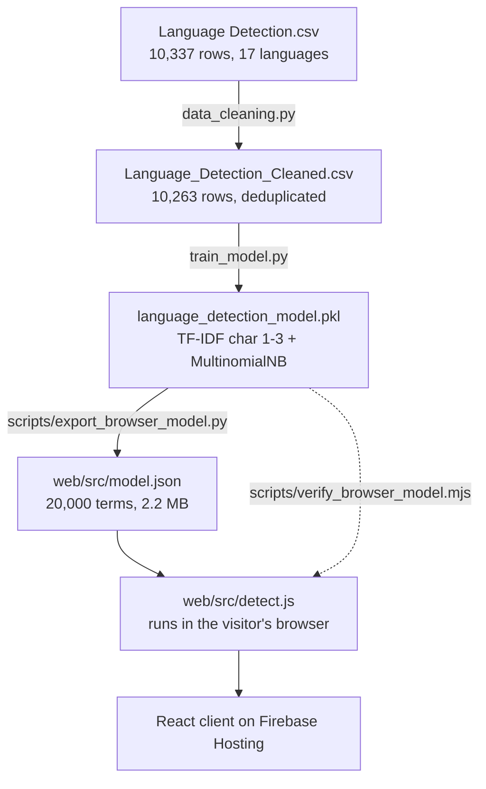

# Architecture

## Shape of the system

There is no server. The dashed edge is the check that makes that safe: the
JavaScript implementation is compared against scikit-learn on the full
held-out set, and must agree on every row.

## The pipeline

**Cleaning** (`data_cleaning.py`) lowercases, keeps letters and the combining
marks attached to them, drops digits, punctuation and symbols, and collapses
whitespace. It deduplicates exact texts, which would otherwise straddle the
train/test split and flatter both sides of it.

The rule is `ch.isalpha() or unicodedata.category(ch).startswith("M")`. Both
halves matter. `isalpha` alone is what the fix originally shipped with, and it
removes 44% of the characters in Tamil, Kannada, Malayalam and Hindi, because
those scripts write vowels and the virama as categories `Mn` and `Mc`. The
classifier still worked, which is precisely why the loss would not have been
noticed by looking at accuracy.

**Features** are character n-grams of length one to three, TF-IDF weighted
with sublinear term frequency, capped at 20,000 terms. Characters rather than
words because languages differ in their letter sequences long before they
differ in vocabulary, and a short input may contain no word the model has seen.

**Classifier** is multinomial naive Bayes with `alpha=0.01` and
`fit_prior=False`.

## Decisions, and what each one rules out

**Uniform class priors.** With fitted priors the classifier inherits the
corpus imbalance. Once cleaning stopped deleting non-Latin scripts the feature
space grew from ASCII to 44,000 n-grams, and Laplace smoothing spread enough
mass across it that small classes could not win: German fell to 16%, with
three quarters of its test rows predicted English, the class with the most
training data. A language detector has no business treating English as more
likely a priori.

**alpha=0.01.** At the default of 1.0 the same collapse happens, more mildly.

**20,000 features.** Measured against the full 44,157: it scores slightly
higher overall and raises the worst class from 94.1% to 96.5%, because the
discarded tail is mostly n-grams seen a handful of times. It also makes the
model small enough to ship to a browser.

**Naive Bayes, not something larger.** Logistic regression and a linear SVM
were fitted on the same features and landed within a tenth of a point. The
model family was never the limitation, so changing it would have disguised a
pipeline fix as a modelling result.

**No backend.** The model is a sparse dot product and an argmax. Keeping a
Python process alive to compute that would add a cold start, a hosting cost
and a failure mode, and would send every visitor's text to a server for no
benefit.

## Evaluation

Per language, never on the aggregate alone. The original model reported 66%
while scoring exactly zero on seven of seventeen languages; an aggregate
assertion would have passed. `tests/test_model.py` asserts a floor on the
worst class, not on the mean.

Held-out set is a stratified 20% split at `random_state=42`, so a small class
like Hindi cannot land mostly on one side.

## Tests

24 tests, run with `pytest`.

- Every script survives cleaning as a non-empty string, and keeps more than
  80% of its characters. This is the regression test for the original bug and
  for the combining-mark bug that the fix introduced.
- The committed cleaned dataset has no blank rows and no missing language.
- No language scores below 90% on held-out text; overall stays above 97%.
- The classifier's priors are uniform.
- The inference path cleans its input, so training and serving cannot drift.

`scripts/verify_browser_model.mjs` is the other half, and is not a unit test:
it requires the JavaScript to reproduce scikit-learn's prediction on all 2,053
held-out rows, with probabilities within 1e-4. It currently agrees on every
row to 1.9e-7.

## Deployment

The client builds with Vite and deploys to Firebase Hosting as a static site.
`model.json` is a separate chunk, so the page paints before the 305 kB
(gzipped) model arrives and becomes interactive once it has.

Nothing a visitor types is transmitted anywhere.
